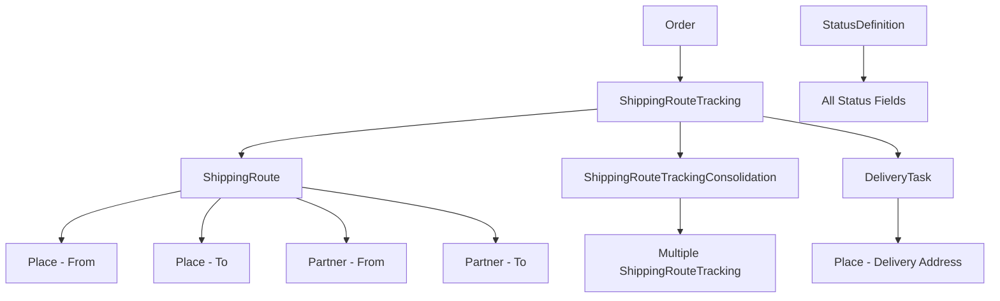

# Shipping System

A comprehensive shipping and tracking system for e-commerce orders with support for multi-hop routes, consolidation, and final delivery.

## Overview

The shipping system tracks customer orders from supplier to final delivery address through multiple transportation routes. It supports consolidation of orders for efficient shipping and provides real-time status tracking.

## Architecture Overview

### Features Structure

The shipping system integrates with other features in the application:
- **Place** (`app.features.place`): Physical locations (airports, ports, warehouses, customer addresses)  
- **Partner** (`app.features.partner`): Business actors (suppliers like Ingram Micro, shipping carriers)
- **Shipping** (`app.features.shipping`): Route management and order tracking

### Core Models

1. **Place** (from `app.features.place`): Physical locations and addresses
2. **Partner** (from `app.features.partner`): Suppliers and carriers  
3. **ShippingRoute**: Defines available transportation routes between places
4. **ShippingRouteTracking**: Tracks customer choices and status for specific orders
5. **ShippingRouteTrackingConsolidation**: Groups multiple orders for batch processing
6. **DeliveryTask**: Manages individual delivery operations
7. **StatusDefinition**: Defines available status codes and their properties

## Core Concept: Bora Bora Customer Example

Let's follow a typical order from a customer on Bora Bora island:

### 1. Customer Order Flow

**Customer**: Lives on Bora Bora island  
**Order**: Places an order for electronics  
**Route Selection**: Customer chooses a shipping path:
1. **Air freight**: Ingram partner → Our warehouse (consolidated with other orders) - `sequence_order=1`
2. **Inter-island freight**: Our warehouse → Bora Bora address (Air Tahiti) - `sequence_order=2`

### 3. Multi-Hop Route Sequencing

Each `ShippingRouteTracking` has a `sequence_order` field to manage multi-step journeys:

- **sequence_order=1**: First route (Ingram → Warehouse)
- **sequence_order=2**: Second route (Warehouse → Bora Bora)
- **Auto-progression**: When route 1 completes → automatically activate route 2

This allows the system to know which route comes next and automatically progress the shipment.

### 2. System Models & Relationships

```
┌─────────────────┐    ┌─────────────────┐    ┌─────────────────┐
│     Partner     │    │      Place      │    │ ShippingRoute   │
│   (Ingram)      │◄──►│   (Warehouse)   │◄──►│ (Air Route)     │
└─────────────────┘    └─────────────────┘    └─────────────────┘
         │                       │                       │
         └─────────────┬─────────────────┬───────────────┘
                       ▼                 ▼
              ┌─────────────────┐ ┌─────────────────┐
              │ShippingRoute    │ │ShippingRoute    │
              │Tracking         │ │TrackingConsol.  │
              │(Order-centric)  │ │(Group status)   │
              └─────────────────┘ └─────────────────┘
                       │                 │
                       ▼                 ▼
              ┌─────────────────┐ ┌─────────────────┐
              │  DeliveryTask   │ │ StatusDefinition│
              │(Final delivery) │ │(Status rules)   │
              └─────────────────┘ └─────────────────┘
```

## Model Details

### Partner
```python
# Ingram supplier partner
{
    "id": "uuid",
    "name": "Ingram Micro",
    "partner_type": "supplier",
    "email": "orders@ingram.com",
    "city": "Los Angeles"
}
```

### Place
```python
# Warehouse location
{
    "id": "uuid", 
    "name": "Papeete Warehouse",
    "type": "warehouse",
    "address": "Zone Industrielle Papeete",
    "country": "French Polynesia",
    "latitude": -17.5516,
    "longitude": -149.5585
}

# Customer address
{
    "id": "uuid",
    "name": "Bora Bora Residential",
    "type": "residential", 
    "address": "Vaitape, Bora Bora",
    "country": "French Polynesia"
}
```

### ShippingRoute
```python
# Route 1: Ingram to Warehouse
{
    "id": "route-1-uuid",
    "name": "Ingram Air Freight",
    "from_place_id": "ingram-warehouse-uuid",
    "to_place_id": "papeete-warehouse-uuid", 
    "from_partner_id": "ingram-uuid",
    "mode": "air",
    "operator": "Air France Cargo",
    "allow_consolidation": true,
    "eta_days": 3
}

# Route 2: Warehouse to Bora Bora  
{
    "id": "route-2-uuid",
    "name": "Air Tahiti Inter-island",
    "from_place_id": "papeete-warehouse-uuid",
    "to_place_id": "bora-bora-address-uuid",
    "mode": "air",
    "operator": "Air Tahiti",
    "is_to_customer": true,
    "eta_days": 1
}
```

### ShippingRouteTracking (Core Tracking)
```python
# Tracks customer's route selection per order
{
    "id": "tracking-1-uuid",
    "order_id": "order-123-uuid",
    "route_id": "route-1-uuid",  # Ingram → Warehouse
    "status_code": "in_transit",
    "consolidation_id": "consol-456-uuid",  # Grouped with other orders
    "selected_at": "2025-09-30T10:00:00Z",
    "tracking_ref": "AF1234567",
    "estimated_delivery": "2025-10-03T12:00:00Z"
}

# Second route for same order
{
    "id": "tracking-2-uuid", 
    "order_id": "order-123-uuid",
    "route_id": "route-2-uuid",  # Warehouse → Bora Bora
    "status_code": "pending",    # Waiting for first route
    "selected_at": "2025-09-30T10:00:00Z"
}
```

### ShippingRouteTrackingConsolidation
```python
# Groups multiple orders on same route
{
    "id": "consol-456-uuid",
    "route_id": "route-1-uuid",
    "name": "AF Cargo Flight 2025-10-01",
    "consolidation_code": "AF-20250930-001",
    "status_code": "in_transit",  # Overrides individual tracking status
    "tracking_ref": "AF1234567",
    "total_orders": 25           # 25 orders in this consolidation
}
```

### DeliveryTask
```python
# Final delivery to customer
{
    "id": "delivery-uuid",
    "order_id": "order-123-uuid", 
    "address_place_id": "bora-bora-address-uuid",
    "delivery_type": "home_delivery",
    "assignee": "Air Tahiti Delivery Service",
    "status_code": "pending"
}
```

## Status Flow Example

### Step-by-step Status Updates

#### 1. Order Placed & Route Selected
```python
# Customer selects routes with sequence
POST /api/shipping/tracking
[
    {
        "order_id": "order-123",
        "route_id": "route-1-uuid",      # Ingram → Warehouse
        "sequence_order": 1,
        "selected_at": "2025-09-30T10:00:00Z"
    },
    {
        "order_id": "order-123", 
        "route_id": "route-2-uuid",      # Warehouse → Bora Bora
        "sequence_order": 2,
        "selected_at": "2025-09-30T10:00:00Z"
    }
]

# Result: 2 ShippingRouteTracking entries created
# Status: "pending" for route 1, "waiting" for route 2
```

#### 2. Consolidation Created
```python
# Orders grouped for efficiency
POST /api/shipping/consolidations
{
    "route_id": "route-1-uuid",
    "name": "AF Cargo Oct 1st",
    "consolidation_code": "AF-20250930-001"
}

# Add our order to consolidation
POST /api/shipping/consolidations/{consol_id}/add-tracking/{tracking_id}

# Status override: tracking-1 now shows consolidation status
```

#### 3. Package Pickup from Ingram
```python
# Update consolidation status
PUT /api/shipping/consolidations/{consol_id}/status
{
    "status_code": "dispatched",
    "update_trackings": true  # Updates all 25 orders in consolidation
}

# Result: All orders in consolidation → "dispatched"
```

#### 4. In Transit to Warehouse
```python
PUT /api/shipping/consolidations/{consol_id}/status
{
    "status_code": "in_transit",
    "tracking_ref": "AF1234567"
}

# Result: All orders → "in_transit" with tracking reference
```

#### 5. Arrival at Warehouse
```python
PUT /api/shipping/consolidations/{consol_id}/status
{
    "status_code": "arrived"
}

# Auto-Route Progression: Route 1 completed → Activate Route 2
POST /api/shipping/tracking/{tracking-1-uuid}/activate-next

# System automatically:
# 1. Marks route 1 (Ingram → Warehouse) as "completed" 
# 2. Finds next route (sequence_order = 2)
# 3. Activates route 2 (Warehouse → Bora Bora) with "in_progress"
}
```

#### 6. Create Final Delivery Task
```python
POST /api/shipping/delivery-tasks
{
    "order_id": "order-123",
    "address_place_id": "bora-bora-address-uuid",
    "delivery_type": "home_delivery",
    "assignee": "Air Tahiti Delivery"
}
```

#### 7. Final Delivery
```python
# Dispatch from warehouse
PUT /api/shipping/tracking/{tracking-2-uuid}/status
{
    "status_code": "dispatched"
}

# Deliver to customer
PUT /api/shipping/delivery-tasks/{task_id}/status
{
    "status_code": "delivered",
    "delivered_at": "2025-10-04T15:30:00Z"
}

# Complete the route tracking
PUT /api/shipping/tracking/{tracking-2-uuid}/status
{
    "status_code": "delivered"
}
```

## Quick Start

### Required Imports

```python
# For API development
from app.features.place.models import Place
from app.features.partner.models import Partner  
from app.features.shipping.models.shipping_route import ShippingRoute
from app.features.shipping.models.shipping_route_tracking import (
    ShippingRouteTracking,
    ShippingRouteTrackingConsolidation
)
from app.features.shipping.models.delivery_task import DeliveryTask
from app.features.shipping.models.status import StatusDefinition
```

### Setup Order

1. Create Places (supplier warehouse, customer address)
2. Create Partners (Ingram, Air Tahiti)  
3. Create ShippingRoutes between places
4. Customer selects route → ShippingRouteTracking
5. Optional consolidation → ShippingRouteTrackingConsolidation
6. Final delivery → DeliveryTask

## API Endpoints

### Route Selection
```bash
# Get available routes from supplier to customer
GET /api/shipping/routes/paths?from_place_id={supplier}&to_place_id={customer}

# Create tracking for selected routes
POST /api/shipping/tracking
```

### Multi-Route Sequencing
```bash
# Get all routes for an order in sequence  
GET /api/shipping/tracking/order/{order_id}/sequence

# Get current active route for order
GET /api/shipping/tracking/order/{order_id}/current

# Auto-activate next route in sequence
POST /api/shipping/tracking/{id}/activate-next

# Manual route progression
PUT /api/shipping/tracking/{id}/complete
```

### Status Management
```bash
# Update individual tracking
PUT /api/shipping/tracking/{id}/status

# Update consolidation (affects all orders)
PUT /api/shipping/consolidations/{id}/status

# Get order status
GET /api/shipping/tracking/order/{order_id}
```

### Consolidation Management
```bash
# Create consolidation
POST /api/shipping/consolidations

# Add/remove orders
POST /api/shipping/consolidations/{id}/add-tracking/{tracking_id}
DELETE /api/shipping/consolidations/{id}/remove-tracking/{tracking_id}
```

### Delivery Management
```bash
# Create delivery task
POST /api/shipping/delivery-tasks

# Update delivery status  
PUT /api/shipping/delivery-tasks/{id}/status
```

## Status Definitions

### Route Tracking Statuses
- `pending`: Route selected, waiting to start
- `ready`: Ready for dispatch 
- `dispatched`: Package picked up/sent
- `in_transit`: Currently moving
- `arrived`: Reached destination
- `delivered`: Final delivery completed

### Consolidation Statuses
- `pending`: Consolidation created, collecting orders
- `ready`: Ready to ship
- `dispatched`: Shipped from origin
- `in_transit`: Moving to destination
- `arrived`: Reached destination
- `closed`: Consolidation completed

### Delivery Task Statuses
- `pending`: Task created, not assigned
- `assigned`: Assigned to delivery person
- `in_progress`: Out for delivery
- `delivered`: Successfully delivered
- `failed`: Delivery failed (retry needed)

## Business Logic

### Consolidation Rules
1. **Automatic Grouping**: Orders on same route can be automatically grouped
2. **Status Override**: When order is in consolidation, consolidation status takes precedence
3. **Status Propagation**: Consolidation status updates propagate to all contained orders
4. **Capacity Management**: Consolidations have limits (weight, volume, count)

### Route Dependencies
1. **Sequential Routes**: Route 2 waits for Route 1 completion
2. **Status Triggers**: Route completion can trigger next route or delivery task
3. **Exception Handling**: Failed routes can trigger alternative routes

### Delivery Coordination
1. **Final Mile**: DeliveryTask created when package reaches final distribution point
2. **Service Selection**: Different delivery services (home, pickup point, Air Moana)
3. **Proof of Delivery**: Photo, signature, GPS location capture

## Model Relationships Summary



## Multi-Route Sequencing Solution

### The Challenge
How does the system know to progress from **Ingram → Warehouse** to **Warehouse → Bora Bora**?

### The Solution: `sequence_order` Field

Each `ShippingRouteTracking` entry has a `sequence_order` field:

```python
# Order creation with route sequence
[
    {
        "order_id": "order-123",
        "route_id": "ingram-to-warehouse-route",
        "sequence_order": 1,           # First step
        "status_code": "pending"
    },
    {
        "order_id": "order-123", 
        "route_id": "warehouse-to-borabora-route",
        "sequence_order": 2,           # Second step
        "status_code": "waiting"       # Waits for step 1
    }
]
```

### Auto-Progression Logic

When route 1 completes:
```python
# System automatically calls:
await crud_shipping_route_tracking.activate_next_route(
    session=session,
    order_id=order_id,
    current_tracking_id=route_1_tracking_id
)

# Result:
# 1. Route 1 → status "completed"  
# 2. Route 2 → status "in_progress"
# 3. Customer gets seamless progression
```

## Key Features

- ✅ **Order-Centric Tracking**: Each order has dedicated tracking entries
- ✅ **Multi-Hop Routes**: Support complex route chains with `sequence_order`
- ✅ **Auto-Route Progression**: Automatic advancement from route to route
- ✅ **Consolidation Support**: Efficient grouping with status override
- ✅ **Real-time Updates**: Status propagation across related entities
- ✅ **Flexible Delivery**: Multiple final delivery options
- ✅ **Partner Integration**: Support for various suppliers and carriers
- ✅ **Geographic Flexibility**: Works with any location/address setup

This system efficiently handles the complexity of multi-island shipping while providing clear tracking and status management for customers and operations teams.